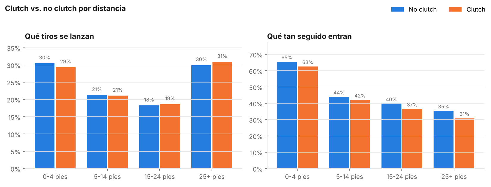
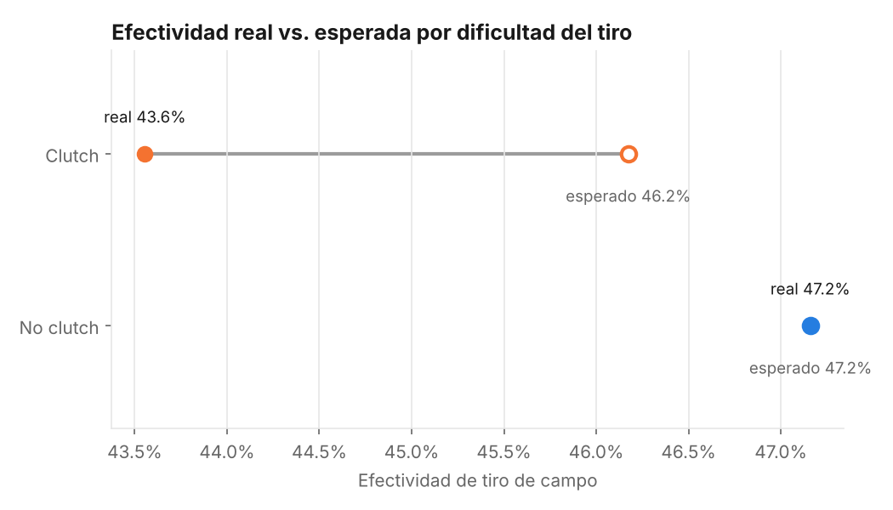
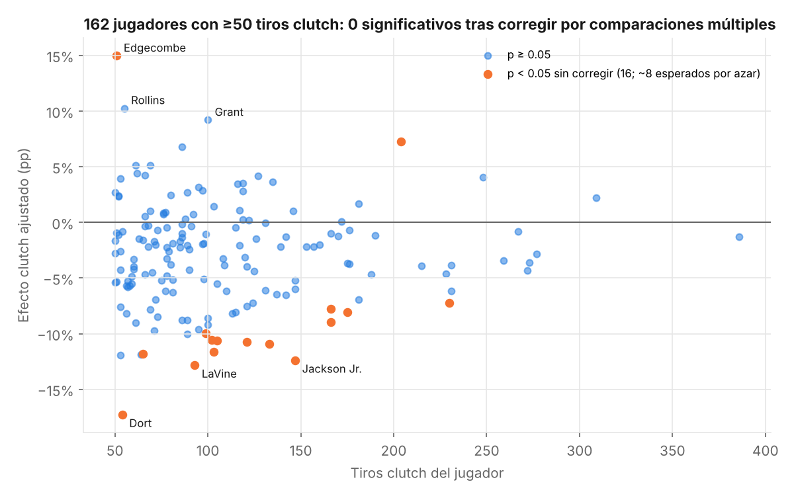
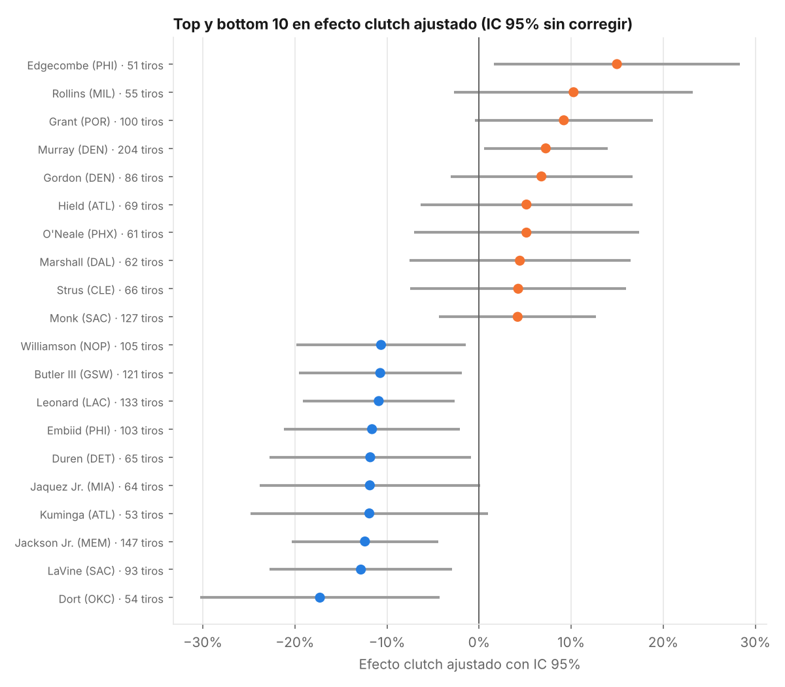

# Reporte final - NBA SHOT IQ

## Resumen ejecutivo

NBA SHOT IQ construye un pipeline reproducible que descarga, limpia, valida y analiza 703,781 intentos de tiro de campo de tres temporadas de la NBA (2023-24 a 2025-26) para responder si existen jugadores con un rendimiento clutch superior al esperado.

En situaciones clutch (últimos 5 minutos del 4.º periodo o tiempo extra, con diferencia de 5 puntos o menos) la liga encesta **43.55%** frente a **47.16%** fuera de clutch: una caída de **-3.60 pp** (IC 95%: -4.25 a -2.96). Un modelo de regresión logística que mide la dificultad de cada tiro indica que en clutch se esperaba un 46.17%, así que solo el 27% de la caída se explica por tiros más difíciles. La caída ajustada es de **-2.62 pp** (IC 95%: -3.23 a -2.01).

A nivel individual se evaluaron 162 jugadores con al menos 50 tiros clutch. **Ninguno** muestra un efecto clutch significativo después de corregir por comparaciones múltiples (Benjamini-Hochberg, q < 0.05). Con estos datos **no se rechaza la hipótesis nula**: las diferencias individuales observadas son compatibles con la variación estadística.

## Problema

Las estadísticas tradicionales permiten saber quién anota más, pero no distinguen si un jugador realmente mejora en los momentos decisivos o si su reputación de "jugador clutch" se debe a la dificultad de sus tiros, al número de oportunidades o al azar. Muchos debates deportivos se basan en pocas jugadas memorables y no en evidencia estadística.

## Pregunta principal

¿Existen jugadores de la NBA cuyo rendimiento en situaciones clutch sea estadísticamente superior al esperado, considerando la dificultad de sus lanzamientos, o las diferencias observadas pueden explicarse por la variación estadística?

- **H0:** después de ajustar por la dificultad del tiro, ningún jugador encesta más de lo esperado en clutch.
- **H1:** algunos jugadores presentan una efectividad significativamente superior a la esperada en clutch.

Preguntas secundarias:

1. ¿Qué tiros ocurren en situación clutch?
2. ¿Qué probabilidad de enceste tiene cada tiro según su distancia, valor y tipo?
3. ¿Qué jugadores encestan más de lo esperado en clutch?
4. ¿Esas diferencias son estadísticamente significativas?
5. ¿Los jugadores rinden mejor en clutch que en sus propios tiros fuera de clutch, después de ajustar por dificultad?

## Fuentes de datos

| Aspecto | Detalle |
|---|---|
| Origen | NBA Stats, publicado por SportsDataverse en GitHub Releases (`nba_stats_shots`) |
| Acceso | API pública de GitHub y descarga de archivos Parquet, sin credenciales |
| Volumen | 3 archivos Parquet (~4.3 MB cada uno), 703,805 registros crudos y 19 columnas |
| Unidad de análisis | Una fila = un intento de tiro de campo de un jugador en un partido |
| Detalle | Ver `docs/data_sources.md` y `docs/data_dictionary.md` |

## Arquitectura

```
SportsDataverse (GitHub Releases)
        |  src/ingestion/download_data.py  (log + manifiesto SHA-256)
        v
data/raw/            Parquet original sin modificar
        |  src/processing/build_dataset.py
        v
data/interim/        limpieza, tipos y duplicados por temporada
        v
data/processed/      shot_detail particionado por season_year + agregados
        |-- src/validation/validate_dataset.py  -> docs/validation.md (60 checks)
        |-- src/analysis/benchmark.py           -> docs/performance.md
        '-- src/analysis/run_analysis.py        -> reports/tables, reports/figures
                                                    '-> reports/NBA_SHOT_IQ_Clutch_Strategy.html
```

Hay además una implementación paralela Bronze/Silver/Gold en Databricks con PySpark (`notebooks/NBA_SHOT_IQ_01_BRONZE_SILVER_GOLD.ipynb`). El análisis local reproduce exactamente sus cifras: 692,926 tiros comparables, 23,483 de ellos clutch.

Todo el pipeline se ejecuta con `python main.py`. El detalle está en `docs/architecture.md`.

## Metodología

1. **Reconstrucción del contexto.** El reloj (`PT04M59.00S`) se convierte en segundos transcurridos. La fuente solo registra el marcador después de un enceste, así que para cada tiro se usa el último marcador conocido de un instante anterior.
2. **Definición clutch.** Últimos 300 segundos del 4.º periodo o cualquier tiempo extra, con diferencia estimada de 5 puntos o menos.
3. **Base comparable.** Se excluyen los instantes ambiguos (varios tiros en el mismo segundo: 2,352 tiros) y los tiros sin marcador previo. Quedan 692,926 tiros.
4. **Modelo de dificultad.** Una regresión logística (scikit-learn) entrenada **solo con tiros no clutch** usa la distancia en pies (0 a 36+), el valor del tiro y el tipo de tiro (`sub_type`, 15 categorías más "Otro"). Se separó un 80/20 para evaluar el modelo.
5. **Efecto a nivel liga.** Compara la efectividad real en clutch contra la probabilidad esperada media, con IC 95% normal.
6. **Efecto por jugador** (mínimo 50 tiros clutch):
   - *Contra la liga:* encestes reales menos esperados en clutch.
   - *Efecto clutch ajustado:* (real − esperado) en clutch menos (real − esperado) fuera de clutch. Compara al jugador contra su propio nivel.
   - p-valor con aproximación normal y **corrección de Benjamini-Hochberg**, porque se prueban 162 jugadores a la vez.
7. **Selección de tiro.** Distribución por rangos de distancia (0-4, 5-14, 15-24 y 25+ pies) y prueba Kolmogorov-Smirnov.

## Procesamiento

- Selección de las 19 columnas de la fuente y conversión de tipos (`is_made`, `points_scored`, `distance_band`).
- Eliminación de 24 duplicados exactos (13 en 2024, 8 en 2025 y 3 en 2026).
- Capa `interim` por temporada y capa `processed` particionada por `season_year`, más agregados por equipo y por jugador.
- Variables del análisis: `segundos_restantes`, `tiempo_transcurrido`, `diferencia_estimada`, `ventana_final`, `clutch`, `instante_ambiguo`, `rango_distancia` y `p_esperada`.
- Exportación de `reports/tables/dashboard_data.csv` (11,282 filas), la misma tabla agregada que usa la página interactiva.

## Validación

- **60 de 60 comprobaciones aprobadas** (`docs/validation.md`): columnas, tipos, faltantes, duplicados, rangos, consistencia temporal, consistencia entre capas y volumen.
- **16 pruebas automatizadas aprobadas** (`python -m unittest discover -s tests`), incluidas 8 nuevas para la lógica clutch: conversión del reloj, uso del marcador *previo*, tiempos extra, exclusión de instantes ambiguos, IC y Benjamini-Hochberg.
- **Validación cruzada:** la versión local en pandas reproduce las cifras del notebook de Databricks (692,926 / 23,483 / 43.55% / 47.16%).
- **Modelo:** AUC 0.658 en el conjunto de prueba y 0.667 en clutch. El log-loss baja de 0.692 (modelo sin variables) a 0.642, y la calibración por deciles sigue la diagonal (`reports/figures/05_calibracion_modelo.png`).
- **Desempeño:** leer Parquet es unas 10 veces más rápido que CSV (0.09 s frente a 0.93 s) y ocupa 7 veces menos disco (`docs/performance.md`).

## Resultados

### R1. Selección y efectividad de tiro en clutch

| Rango | % de tiros (no clutch → clutch) | Efectividad (no clutch → clutch) |
|---|---|---|
| 0-4 pies | 30.5% → 29.3% | 65.5% → 62.5% |
| 5-14 pies | 21.3% → 21.1% | 44.0% → 42.0% |
| 15-24 pies | 18.3% → 18.6% | 39.7% → 36.6% |
| 25+ pies | 30.0% → 30.9% | 35.4% → 30.8% |

La mezcla de distancias casi no cambia: el porcentaje de triples es 41.1% fuera de clutch y 41.4% en clutch. KS detecta una diferencia (D = 0.023, p ≈ 5e-11), pero es muy pequeña y significativa solo por el tamaño de la muestra. La efectividad baja en **todos** los rangos, sobre todo en tiros de 25+ pies (−4.6 pp). Los puntos por tiro bajan de 1.092 a 1.002.



### R2. La caída no se explica solo por la dificultad

| | Real | Esperado por dificultad | Diferencia |
|---|---|---|---|
| No clutch | 47.16% | 47.16% | 0.00 pp |
| Clutch | 43.55% | 46.17% | **−2.62 pp** (IC 95%: −3.23 a −2.01) |



### R3. No hay jugadores clutch estadísticamente superiores

- Jugadores evaluados: **162**, con al menos 50 tiros clutch cada uno.
- Con p < 0.05 sin corregir: **16**, cuando por azar se esperarían ~8. De esos 16, 14 son negativos, lo que refleja la caída general de la liga.
- Significativos tras Benjamini-Hochberg: **0**.
- Los efectos más extremos (Edgecombe +15 pp con 51 tiros, Dort −17 pp con 54 tiros) aparecen en jugadores con pocos tiros: es el patrón de embudo típico del ruido estadístico.
- Murray y Gilgeous-Alexander superan con claridad a la liga en clutch (z de 2.9 y 2.7), pero también lo hacen fuera de clutch. Su efecto respecto a su propio nivel no es significativo (q = 0.38 y q = 0.67). Superar a la liga refleja calidad general, no un efecto clutch.




Tabla completa: `reports/tables/jugadores_clutch_ajustado.csv`.

### R4. Herramienta interactiva

`reports/NBA_SHOT_IQ_Clutch_Strategy.html` permite explorar la efectividad por jugador, equipo, temporada y distancia, comparar contra el promedio de la liga desde la misma distancia (con suavizado de muestras pequeñas) y generar propuestas ofensivas y defensivas exploratorias. Sus datos son `reports/tables/dashboard_data.csv`.

## Limitaciones

- **Marcador estimado.** La fuente registra el marcador solo tras encestes de campo y no incluye tiros libres, así que la diferencia puede estar desfasada unos puntos.
- **Instantes simultáneos.** El 0.3% de los tiros comparte segundo con otro tiro y se excluyó por ambigüedad.
- **Variables omitidas.** No hay datos de la defensa, del cansancio, de la calidad del pase ni del reloj de posesión. El AUC de 0.66 indica que buena parte de la dificultad no es observable.
- **Potencia estadística.** Tres temporadas dan entre 50 y 400 tiros clutch por jugador, insuficiente para detectar efectos individuales de 2-3 pp.
- **Independencia.** Los tiros de un mismo jugador o partido están correlacionados, así que los p-valores son aproximados.
- **Causalidad.** El análisis es observacional: describe asociaciones, no causas.
- **Nombres.** La fuente solo trae apellidos; los jugadores se identifican por `person_id`.

## Conclusiones

1. En clutch la NBA encesta 3.6 pp menos. Unas tres cuartas partes de esa caída **persisten** después de ajustar por la dificultad del tiro (−2.6 pp), lo que sugiere un efecto real del contexto de presión o de la defensa.
2. Los equipos **no cambian mucho qué tiros lanzan** en clutch; lo que cambia es cuántos entran.
3. **No se rechaza H0.** Ningún jugador muestra un rendimiento clutch superior al esperado que sobreviva a la corrección por comparaciones múltiples. Las "estrellas clutch" de este periodo se explican mejor por su calidad general y por la variación estadística.
4. Para la toma de decisiones, conviene darle el último tiro al jugador más eficiente en general y no a quien tenga fama de clutch.

## Trabajo futuro

- Ampliar a más temporadas para ganar potencia estadística por jugador.
- Integrar play-by-play completo (tiros libres) para reconstruir el marcador exacto.
- Modelos jerárquicos (bayesianos) que encojan los efectos individuales hacia la media de la liga.
- Agregar datos de seguimiento (distancia del defensor) para mejorar el modelo de dificultad.
- Retomar los módulos Hot Hand y Shot Selection por equipo.
- Orquestar el pipeline en Databricks Jobs para actualizaciones automáticas.
